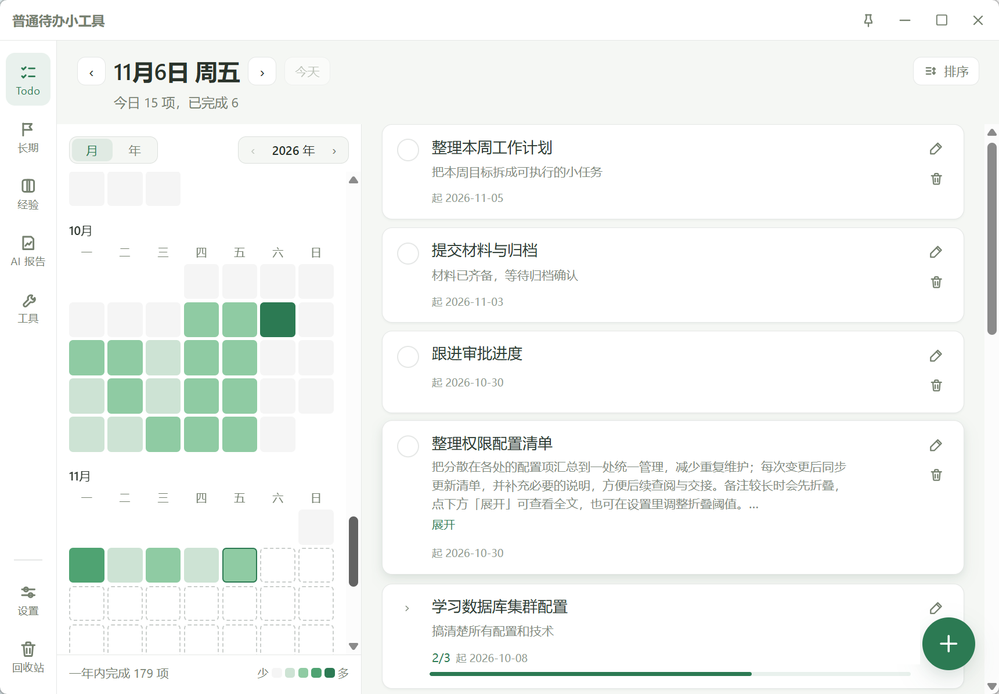
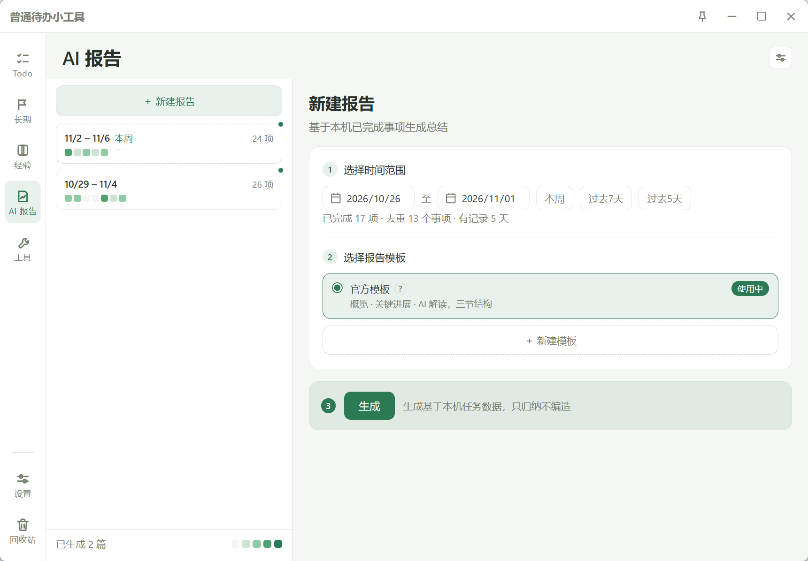
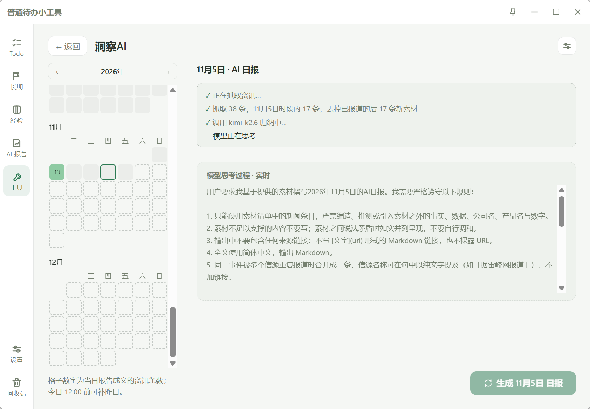
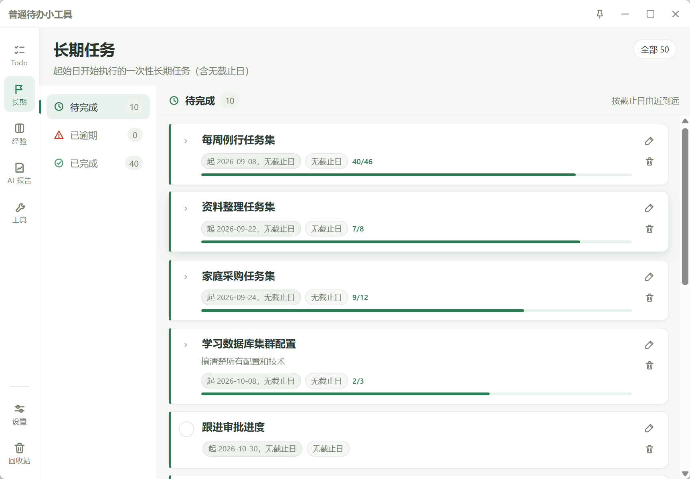
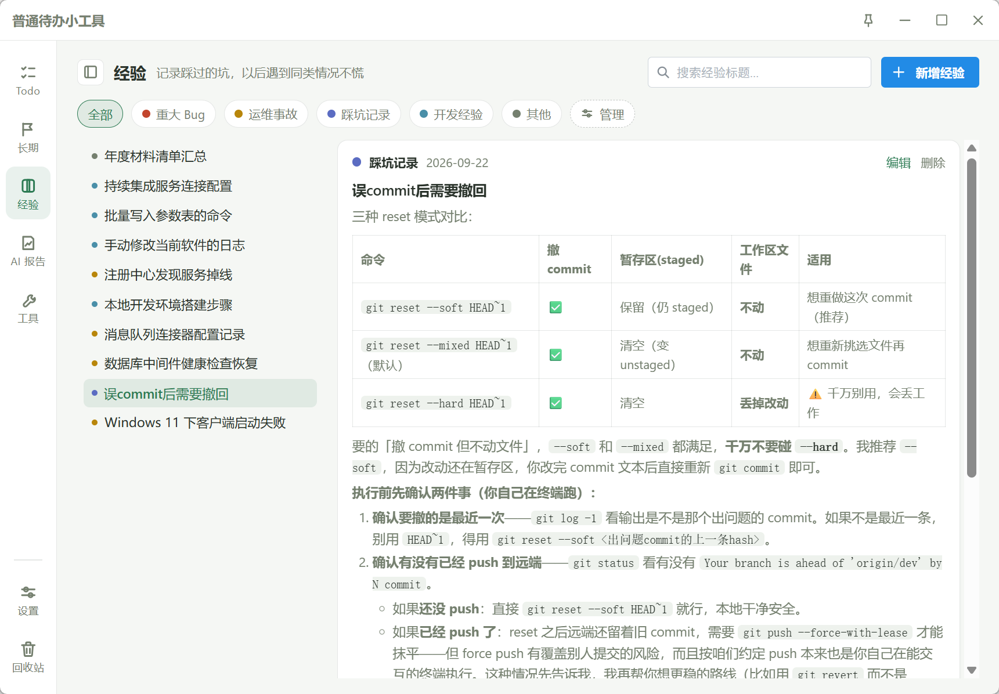

# DailyTodo

> Windows 本地轻量待办工具。周期任务 + 一次性任务混合管理，任务数据全部落在本机 JSON，无需账号、无需服务端。



采用 Tauri 2 + React 18 + TypeScript：业务逻辑全部由 TypeScript 实现，Rust 侧只保留 Tauri 系统能力（托盘、窗口、单实例、磨砂背板，以及为公开资讯抓取提供 HTTP 通路）。当前版本 `0.4.0`。

**联网边界**：核心待办完全离线。仅两处会联网——节假日数据按年份首次需要时只读拉取一次 holiday-cn 静态 JSON 并落盘（5 秒超时后降级为按星期判断）；AI 功能在用户自带 API Key 并主动触发时访问自配模型服务与公开资讯源。任务数据不上传，不后台定时联网。

---

## 功能特性

### 任务管理

- **六种周期类型**：仅一次（once）、工作日（workday）、非工作日（weekend）、每天（daily）、每周指定几天（weekly）、特殊周期（special：每 N 天 / 每 N 周指定星期 / 每 N 月指定几号、第几个星期几或最后一天）
- **周期任务不展开存储**：用 `schedule`（周期规则）+ `instances`（日期 → 完成记录）映射表达，避免数据膨胀
- **复合任务集（composite）**：一条父任务下挂多条带独立截止日的子任务，仅两级关系
- **DDL 扩展**：跨天一次性任务的 `completedAt` 永久完成日期、长期 DDL 判定、紧迫度色阶与「已过期」徽章
- **日清单**：拖拽排序固化相对顺序，DDL 自动置顶让位于用户顺序；支持按截止维度排序、今日截止徽章、超长备注折叠（阈值可配）
- **提醒**：到点触发系统通知（`plugin-notification`），基于本机 `setTimeout` 调度，仅进程存活时生效

### AI 能力（可选，需自配 API）

- **AI 报告**：按区间汇总已完成任务生成工作总结，支持模板库（自建 / AI 润色 / 粘贴识别）、流式生成、思考过程展示与切页不中断的后台任务
- **洞察AI**（工具页 · 科技分类）：先抓真实资讯再交模型归纳的每日日报，提示词硬性禁止编造；年历贡献墙、合并式补充加载、按天存档
- **行业资讯**：按行业实测验证专属信源，可梳理上下游、合并行业与历史日报
- **统一配置**：设置页「AI 服务」与工具页共用同一份服务商配置（地址 / Key / 模型 / 模型列表缓存），OpenAI 兼容协议
- **共同管线**：SSE 流式预览、超时与截断保护、报告按渠道按天存 `<数据根>/insights.json` 并滚动保留 30 天

### 视图（侧栏 7 个）

| 视图 | 说明 |
| --- | --- |
| **Todo** | 分栏工作台：左栏月历化贡献墙（月 / 年轨道切换），右栏当日清单 |
| **长期** | 长期任务预览页，按 待完成 / 已逾期 / 已完成 三组可折叠展示 |
| **经验** | Markdown 笔记，含分类管理、日期侧轨、图片附件、CodeMirror 编辑器与实时预览 |
| **AI 报告** | 区间工作总结生成页，含报告模板库与周条视图 |
| **工具** | 工具集合页：洞察AI、行业资讯、糊弄学等 |
| **设置** | 数据目录、布局模式、节假日源、自启、AI 服务、备注折叠阈值、关闭按钮行为等 |
| **回收站** | 删除任务按保留天数暂存，可恢复 |

### 系统能力

- 悬浮窗模式（普通窗口 ↔ 悬浮窗形态切换）与简易模式（仅当日待办）
- 系统托盘 + 原生菜单、开机自启、单实例；关闭窗口行为可配置（收进托盘常驻或直接退出）
- 磨砂背板（Mica / Acrylic，Win10 降级为半透明纯色）、无边框自绘标题栏

### 数据与可靠性

- **本地 JSON 存储**：默认 `%APPDATA%/com.yoyo.dailytodo/DailyTodo/`，可在设置页自定义并迁移（目录指针放在 `appDataDir` 根）；dev 与 release 使用各自指针，互不干扰
- **构建模式隔离**：dev 按任务类型分文件 `<数据根>/tasks/<type>.json`，无法解析的单条任务隔离进 `<type>.quarantine.json`；release 保持单文件 `tasks.json`
- **版本兼容**：闸门为「最低兼容版本」而非精确相等，加载时 merge 出厂值 + normalize 补齐缺失字段，不因新增字段判废整份文件
- **原子写**：写 `.tmp` → `remove` → `rename`，防中途崩溃损坏
- **备份与兜底**：每日备份保留最近 7 份（源文件内容合法才备份）；加载时校验结构，损坏则自动回退备份并提示原文件已另存
- **节假日识别**：缓存优先 → 联网（5s 超时）→ 星期降级三级策略，基于 holiday-cn 数据

---

## 界面速览

> 顶部封面为 Todo 工作台。以下截图均为示例数据，涉及真实项目 / 平台名称的标题已做脱敏替换。

### AI 报告



按区间汇总已完成任务生成工作总结，左侧周条展示已生成报告的区间与完成数量，右侧选时间范围与模板后生成。

### 洞察AI（工具页 · 科技分类）



左栏年历按当日报告条数着色，右栏先抓真实资讯再交模型归纳；图为生成过程，进度日志与模型思考过程实时可见。

### 长期任务



按 待完成 / 已逾期 / 已完成 分组，任务集带子任务进度条，长期 DDL 用左侧色条与紧迫度表达。

### 经验



左栏按分类色点组织笔记标题，右侧 Markdown 实时预览（表格、行内代码、加粗均支持）。

---

## 技术栈

| 层 | 技术 |
| --- | --- |
| 桌面框架 | Tauri 2 |
| 前端 | React 18 + TypeScript 5 + Vite 6 |
| UI 库 | Mantine 7 |
| 状态管理 | zustand 5 |
| 日期 | date-fns 4 |
| Markdown | react-markdown + remark-gfm + CodeMirror 6 |
| Rust 侧 | tauri 2 + window-vibrancy + 官方插件集（fs / http / dialog / notification / autostart / single-instance / opener） |

---

## 快速开始

### 环境依赖

- **Node.js 18+**（推荐 LTS）
- **Rust stable**（通过 rustup 安装）
- **WebView2 Evergreen Runtime**：Windows 11 内置；Windows 10 1809+ 若未预装需单独安装，Tauri 安装包会自动引导

### 安装与开发

```bash
npm install

# 日常开发（推荐）：前端走 Vite dev server，改 TSX 保存即见热更新
npm run tauri dev

# 仅调试前端（不启 Rust 侧，系统能力不可用）
npm run dev
```

> 修改 `src-tauri/` 下的 Rust 代码或 `tauri.conf.json` 需重启 dev 进程，热更新不覆盖。

### 打包与发布

```bash
npm run tauri build
```

产出 `src-tauri/target/release/daily-todo.exe` 与 `bundle/nsis/` 下的 NSIS 安装包（可执行文件名取自 Cargo `[package] name`，而非 productName）。外发给他人时用安装包：它会补装 WebView2、创建快捷方式；裸 exe 无快捷方式可能导致通知不弹、挪位置后开机自启失效。未签名产物首次运行会触发 SmartScreen。

---

## 项目结构

```
.
├── index.html                  主窗口入口
├── vite.config.ts              Vite 构建配置（多入口）
├── package.json
├── AGENTS.md                   AI 协作约定
├── _resources/                 README 截图（示例数据，已脱敏）
├── docs/                       设计文档与开发记录
│   ├── 01-架构设计.md
│   ├── 开发记录.md             开发过程记录
│   └── 特殊周期设计.md 等
├── src/                        前端：React 18 + TypeScript
│   ├── main.tsx                主窗口入口
│   ├── App.tsx                 装配：标题栏 + 侧栏 + 视图区
│   ├── types/                  纯类型定义，零运行时依赖
│   ├── constants/              常量集中（魔法数字归口）
│   ├── lib/                    ★ 纯函数层：业务逻辑核心
│   ├── services/               ★ 副作用层：IO、网络、计时器
│   ├── bridge/                 宿主能力门面（Tauri API 降级封装）
│   ├── stores/                 zustand：单一数据源
│   ├── components/             通用组件（跨视图复用）
│   ├── views/                  页面级视图（Todo / 长期 / 经验 / AI 报告 / 工具 / 设置 / 回收站）
│   ├── pet/                    独立窗口入口
│   ├── hooks/
│   └── styles/                 CSS 变量主题 + 全局样式
└── src-tauri/                  Rust 侧：仅系统能力
    ├── Cargo.toml
    ├── tauri.conf.json         窗口/打包/权限配置
    ├── capabilities/           最小权限声明
    └── src/                    main.rs / lib.rs / commands.rs（≤3 文件）
```

---

## 架构与设计约束

### 分层依赖方向（自上而下，反向依赖视为缺陷）

```
views / components / pet  →  stores  →  lib（纯） + services（副作用）  →  bridge  →  Rust
```

三条硬规则：

1. **`src/lib/`** 禁止 import `@tauri-apps/*`、`react`、`zustand`，只允许 `date-fns` 与本项目的 `types/` `constants/`——保证业务逻辑可独立单测
2. **`src/services/`** 是唯一碰宿主能力的地方，且必须通过 `bridge/` 调用（例外：`plugin-fs` 读写原语由 `services/storage.ts` 直接使用）
3. **组件**不得直接读写 store 以外的数据源，不发 fetch、不读文件

### Rust 使用边界（硬性）

- Rust 源文件总数不超过 3 个（`main.rs` / `lib.rs` / `commands.rs`）
- 单个 Rust 函数不超过 50 行
- 业务逻辑（周期计算、节假日、完成率、日期处理）一律 TypeScript，禁止下沉 Rust
- 文件读写由 TS 侧 `@tauri-apps/plugin-fs` 完成，不为此写 Rust command
- `fetch_public_text` 是唯一例外：为绕开 WebView 的 CORS 限制，用 Rust 侧 HTTP 通道抓取**公开** RSS，仅允许 HTTP(S) 域名，拒绝 localhost / `.local` / IP 字面量；模型 API 与 Key 仍走前端直连

### 主题

所有颜色走 CSS 变量（`src/styles/theme.css`），组件内禁止硬编码色值；深色色板已定义。
