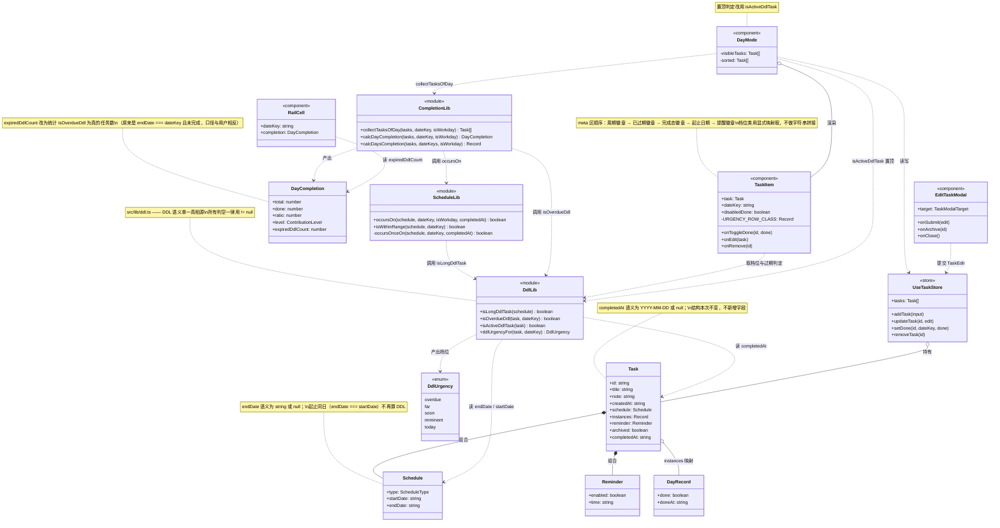
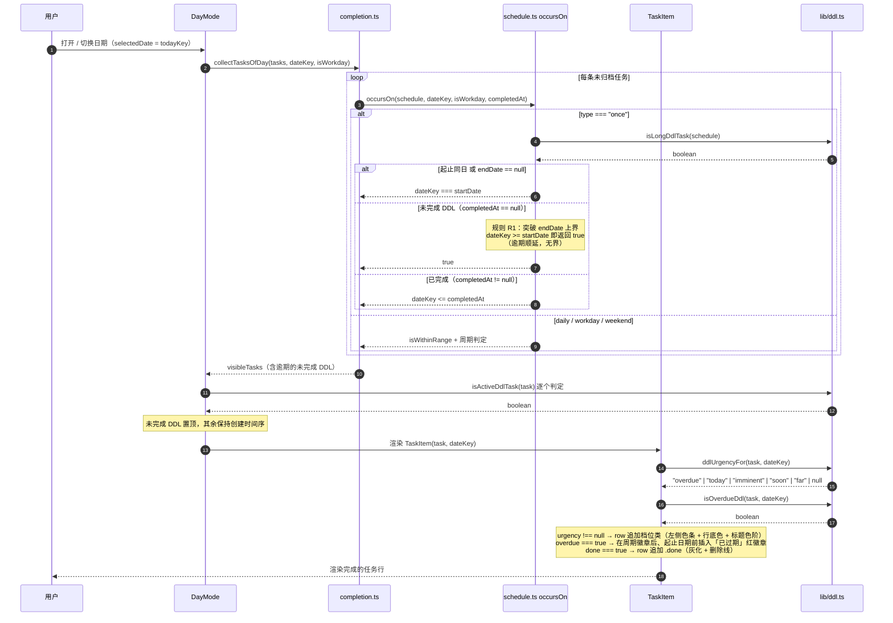
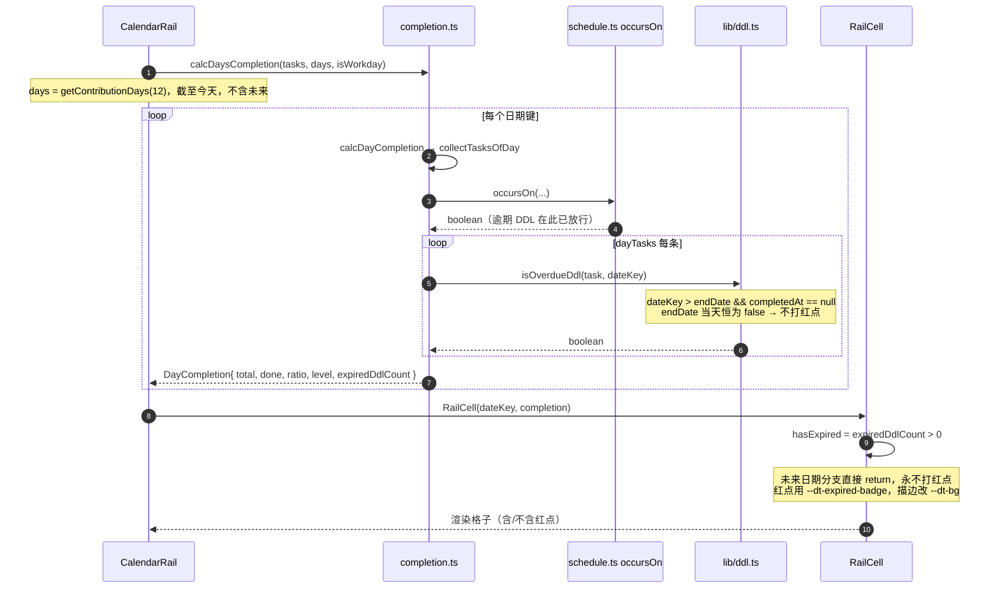
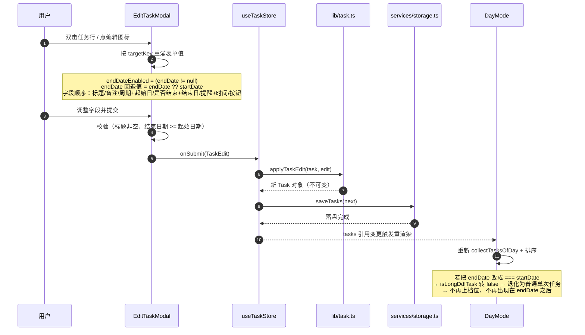
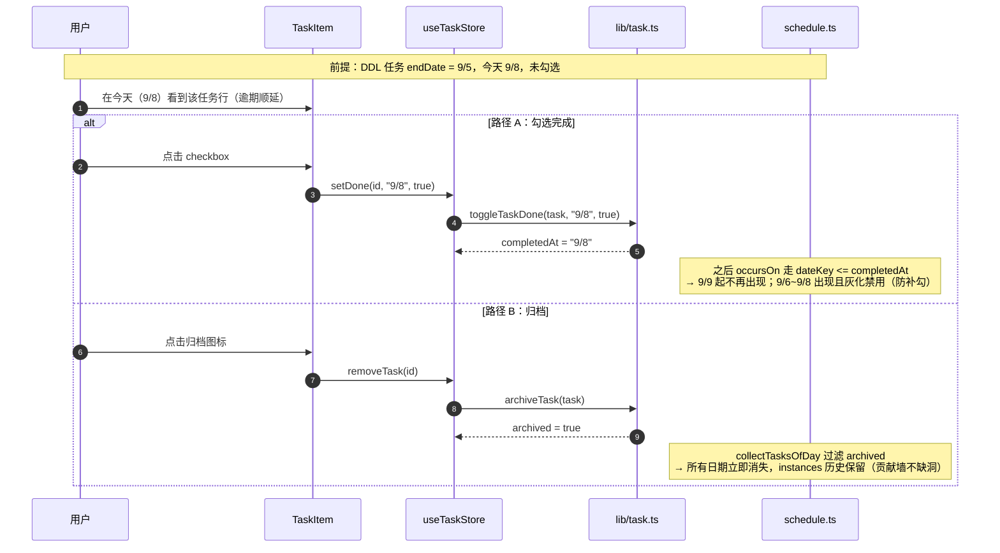
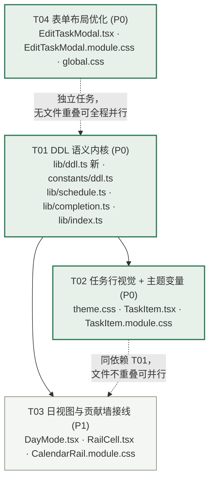

# DailyTodo 系统设计（DDL 语义重定义 + 任务行视觉 + 表单布局）

版本：v1（增量设计）
作者：高见远（架构师）
上游输入：许清楚的增量 PRD（DDL-1~DDL-4、FORM-1~FORM-2、验收矩阵 8 条）
依据：`AGENTS.md`（五、协作与代码规范）、`.workbuddy/memory/MEMORY.md`（数据兼容性硬规则）

> **本设计为增量设计，只覆盖本次改动面。** 未列出的模块（存储、备份、节假日、提醒、桌宠、设置页）保持不变。

---

## Part A：系统设计

### 1. 实现方案

#### 1.1 核心技术难点

本次改动面看着是"改几个 if + 加几个 CSS 类"，但有四个真实难点，必须先想清楚：

| # | 难点 | 本质 | 解法 |
|---|---|---|---|
| N1 | **过期任务不出现在日清单，但"已过期"徽章要出现在任务行上** | `isWithinRange()` 用 `endDate` 做上界过滤，过期任务被物理过滤掉，任务行根本不渲染 | **逾期顺延**：未完成的 DDL 任务突破 `endDate` 上界，持续可见（详见 1.3） |
| N2 | **DDL 语义口径散落在 4 处，各写各的** | `TaskItem` 内联 `type==="once" && endDate !== null`；`DayMode` 又内联一遍加了 `completedAt===null`；`completion.ts` 用 `endDate === dateKey`；`constants/ddl.ts` 用 `diff<0 → null` | 抽 `src/lib/ddl.ts` 单一真相源，四个判定全部收敛 |
| N3 | **视觉语义反转**：原来把档位色灌进徽章，新需求是整行变深 + 徽章不染色 | `badgeStyle` inline style 与"整条目变深"意图相反 | 删除 inline 染色，改 CSS Module 档位类 + 左侧伪元素色条 + 标题色阶 |
| N4 | **表单"太丑"是复合问题**：间距散 + 开关与输入框基线错位 | `Stack gap="sm"` 偏松；`Group grow align="flex-end"` 只对齐了容器底边，开关（20px）与输入框（36px）高度差导致视觉下沉 | `gap="xs"` + 给开关套固定高度容器做垂直居中（详见 1.5） |

#### 1.2 框架选型

**不引入任何新依赖。** 沿用现有技术栈：

| 层 | 选型 | 本次用法 |
|---|---|---|
| 桌面壳 | Tauri 2 | 不涉及 |
| UI | React 18 + TypeScript strict | `TaskItem` / `EditTaskModal` / `RailCell` 改渲染 |
| 组件库 | Mantine 7 | 表单布局只调 `Stack gap` / `Group grow` / `Modal`，**不动主题色板、不引入新组件库**（PRD 约束） |
| 状态 | zustand 5 | 不涉及（无新状态） |
| 样式 | CSS Modules + `theme.css` CSS 变量 | 全部新增色值走 CSS 变量，组件内零硬编码 |
| 日期 | date-fns 4 | 复用 `daysBetweenKeys` |

架构模式：沿用现有 **分层纯函数 + 容器组件** 模式 —— 语义判定下沉到 `src/lib/`（纯函数、不碰 React/IO），组件只做渲染与事件转发。本次把 DDL 语义从"组件内联"和"constants 层"统一收回到 `src/lib/ddl.ts`，是对既有分层的一次纠偏。

#### 1.3 ⚠ 关键矛盾点的决策（N1）

##### 三个方向评估

| 方向 | 做法 | 验收矩阵 case 1 | 用户心智 | 风险 |
|---|---|---|---|---|
| **A** | 放宽区间，未完成 DDL 在 `endDate` 之后仍进日清单 | ✅ 通过 | ✅ 吻合 | 老任务长期滞留 |
| **B** | 过期任务只在 `endDate` 当天显示 | ❌ **不通过** | ❌ 不符 | 用户明天看不到 |
| **C** | 独立"逾期区"UI | ✅ 通过 | ⚠ 部分 | 新增 UI 区域，超出 PRD 范围 |

**方向 B 被验收矩阵直接否决**，理由：case 1 要求 `end < today && !done` 时**任务行**显示"已过期"徽章。任务行只渲染 `collectTasksOfDay(tasks, selectedDate)` 的结果，而默认 `selectedDate = todayKey()`（`useViewStore.ts:33`）。若 `dateKey > endDate` 一律返回 false，今天（= endDate+1）的任务行根本不存在，徽章无处安放。

**方向 C 超出 PRD 范围**（PRD 明确要求徽章挂在任务行上，位置在周期徽章右侧、起止日期之前）。

##### 最终决策：方向 A′ —— 逾期顺延可见（无界）

> **规则 R1**：`once` 且 `endDate != null` 且 `endDate !== startDate` 的任务（= DDL 任务），
> 在 `dateKey >= startDate` 的前提下：
> - **未完成**（`completedAt == null`）：**始终出现**，不受 `endDate` 上界限制；
> - **已完成**（`completedAt != null`）：仅 `dateKey <= completedAt` 时出现（沿用现状）；
> - **已归档**：永不出现（沿用现状）。

**为什么选"无界"而不是"滞留 N 天后消失"：**

一开始考虑过加 `DDL_OVERDUE_CARRY_DAYS = 7` 之类的滞留窗口。否决，理由是本项目对"东西凭空消失"零容忍 —— `MEMORY.md` 记录过一次因校验过严导致整份 `tasks.json` 判废、数据看似消失的事故。任务在第 8 天从清单里消失，用户同样会以为数据丢了。**宁可让它一直挂着，也不要让它悄悄消失。**

且本方案有两个明确的收敛出口，用户完全可控：
1. 勾选完成 → `completedAt` 落定 → 只在完成日及之前出现；
2. 归档 → 从所有日期消失。

**为什么"无界"不会失控（副作用可接受性分析）：**

现状 DDL 任务**本来就在 `[startDate, endDate]` 全区间每天出现**（`occursOn` once 分支 `// 未完成：整天显示 return true`）。也就是说，一个 `start=9/1, end=9/30` 的 DDL 任务现在就已经占了 30 天的清单和 30 天的完成率分母。顺延只是把这个区间向右延长，**不是质变**。

##### 副作用一：贡献墙红点会连成「红带」（**必须修，P0**）

产品经理许清楚在复核时抓到这条，我确认成立 —— 这是我第一版设计的漏算（只在任务行层面想过，没在年视图 365 格的密度上想过）。

链路：
- `calcDayCompletion` 按 `dateKey` **逐日独立**统计 `expiredDdlCount`（`completion.ts:53`）；
- `calcDaysCompletion` 对窗口内每一天调用一次（`completion.ts:92-94`）；
- `RailCell` 每格独立判断 `hasExpired`（`RailCell.tsx:25`）。

叠加 A′ 的"无界顺延"后：一条 `endDate = 9/1` 的未完成任务拖到 9/30，**9/2 ~ 9/30 共 29 个格子全部挂红点**，年视图里连成一条红带，彻底压过完成度色阶，贡献墙可读性归零。

**收敛方案：红点只挂在「今天」这一格。**

| 候选 | 做法 | 红点数 | 今天可见 | 是否误导 | 结论 |
|---|---|---|---|---|---|
| A | 逐日挂（原设计） | N 天 | ✓ | 否 | ❌ 成红带 |
| B | 只在 `endDate + 1` 挂一次 | 1 | ✗ | **是** | ❌ 否决 |
| **C** | **只在 `todayKey()` 挂** | **1** | **✓** | **否** | ✅ **采用** |

否决 B 的理由（许清楚原提议 B，我改选 C）：

1. **B 会误导**。拖 30 天后，今天的格子**没有红点**，用户扫一眼墙会以为"今天没有欠债"了 —— 这比红带更糟：红带只是难看，误导是**错的**；
2. **B 会丢失**。若 `endDate + 1` 落在 12 个月窗口之外（老任务），红点**完全不显示**；C 恒在窗口内（`getContributionDays` 截止今天）；
3. **B 的视觉位置不对**。贡献墙的视线焦点是最新一列，红点作为"警示"该落在焦点上，而不是藏在几十天前的一个孤立格子里；
4. **C 的语义最贴合用户原话**："到明天了还没勾选，那才算过期" —— C 下红点读出来就是"到今天为止还有 N 项逾期"，是**当前状态**而非历史事件，与 `isOverdueDdl` 的口径自洽。

代价（已接受）：历史上"哪天开始欠债"在墙上读不出来。该信息在日清单里由「已过期」徽章 + 「起 X 止 Y」文本完整承载，贡献墙的职责是密度概览，不承担欠债久期的表达。

**实现位置**：`calcDaysCompletion` 末尾加一段后处理，非今天格子的 `expiredDdlCount` 清零。**不改 `calcDayCompletion` 签名**（单日调用仍返回该日原始逾期数，语义正确且单测不破）。

##### 副作用二：完成率被压低 —— **经核实，UI 上不存在此问题**

许清楚担心"逾期任务混入完成率分母，会让指标永久压在 100% 以下、失去激励作用"。我核了全部消费方，结论是这个担心**在当前 UI 上不成立**（下表为 `grep` 全量结果）：

| 字段 | 消费方 | 逾期任务是否影响 |
|---|---|---|
| `ratio` | **零消费方**（死字段，仅 `completion.ts:63` 自身赋值） | 影响，但**无人读取** |
| `level` | `RailCell` 贡献墙色阶，由 `countToLevel(done, maxDone)` 得出 | **不受影响**（只看 `done`，不看 `total`） |
| `total` | `TodoView.tsx:26` 统计行「今日 N 项，已完成 M」 | 影响（数字变大） |
| `done` | 同上 + `CalendarRail` 年度累计 | 不受影响 |

因此：
- **`total` / `done` 保持不变**。`total` 的唯一消费方是「今日 N 项」文案，它**必须等于日清单实际列出的条数**。若按"排除逾期"去改，用户会看到「今日 2 项」但列表里有 3 条（含 1 条逾期）—— **数字与列表对不上，这是引入新 bug**，比原问题更严重；
- **`ratio` 顺手改为排除逾期任务统计**。当前无消费方，零风险，但保持口径正确，避免将来有人拿去用时踩坑；
- **不新增"逾期自动归档"**。许清楚也明确反对，我同意：本项目"归档"是删除的替代语义，自动触发会让用户觉得数据被偷走，且 N 天的边界纯属拍脑袋。

##### 规则 R1 的四个边界行为（工程师实现后请逐条自测）

| 场景 | 行为 | 说明 |
|---|---|---|
| 选中**未来日期**（如 2027-01-01） | 逾期 DDL 仍出现 | 与"无界"一致；未来日 `disabledDone=true`，勾选仍禁用 |
| 选中 `endDate` **当天** | 出现，档位 `today`（最深），**无**"已过期"徽章 | DDL-2 硬口径 |
| 选中 `endDate` 之后、完成日之前的**历史日** | 出现，档位 `overdue`，有"已过期"徽章 | 补勾防护：若 `completedAt > dateKey` 则行灰化且 checkbox 禁用（沿用 `isDdlPastDay`） |
| 选中**完成日之后**的日期 | 不出现 | `dateKey <= completedAt` 收敛 |

> 简易模式（`SimpleModeView` 复用 `DayMode` 且锁定 `selectedDate = todayKey()`）会同步出现逾期任务 —— 见 §5 待明确第 3 条。

#### 1.4 DDL 语义的单一真相源（N2）

新增 `src/lib/ddl.ts`，导出四个纯函数。**所有 DDL 判定必须从这里取，禁止任何组件再内联 `type === "once" && endDate !== null`。**

```
isLongDdlTask(schedule)          → DDL-1：是不是"跨天 DDL 任务"（起止同日不算）
isOverdueDdl(task, dateKey)      → DDL-2：在该日期键上是否已过期
isActiveDdlTask(task)            → 未完成 DDL（日清单置顶用）
ddlUrgencyFor(task, dateKey)     → 视觉档位（含 overdue）
```

为什么把 `ddlUrgencyFor` 从 `src/constants/ddl.ts` **迁到** `src/lib/ddl.ts`：

- 现状 `constants/ddl.ts` 里放了一个 `import { daysBetweenKeys } from "@/lib"` 的函数 —— constants 层反向依赖 lib 层，分层是倒挂的；
- 新签名要吃 `Task`（需要读 `completedAt` 才能判"已完成 → 不参与档位"），constants 层不该持有领域实体的判定逻辑；
- 迁走后 `constants/ddl.ts` 回归纯常量 + 类型，职责干净。

调用点只有 `TaskItem.tsx` 一处（`grep` 已确认），迁移成本 = 改 1 行 import。

#### 1.5 视觉语言转向（N3）

**DDL-4 三层视觉，全部走 CSS 变量，徽章一律不染色：**

| 层 | 载体 | 实现 |
|---|---|---|
| ① 左侧竖向色条 | `.row::before` 伪元素，`width: 3px` 通高 | `background: var(--dt-ddl-bar-*)`，5 档 |
| ② 整行底色递进 | `.row` 的 `background` 被档位类覆盖 | `var(--dt-ddl-row-*)`，4 档（far 不变） |
| ③ 标题色阶递进 | `.title` 的 `color` 被档位类覆盖 | `var(--dt-ddl-title-*)`，3 档（far/soon 用正文色） |

**配色方向：低饱和灰 → 深暖灰**（PRD 待确认项 1 的默认方案）。**刻意避开红橙系**，避免与"已过期"红徽章和贡献墙红点撞色 —— 紧迫度用"深浅"表达，过期用"红色"表达，两套语义各占一个通道，互不干扰。

**过期档特殊处理**（PRD 待确认项 2 默认方案）：整行**不用红底**，用中性偏暖灰底 `--dt-ddl-row-overdue`，视觉重量靠"红色标题 + 红色徽章"承担。理由：整行红底在小尺寸任务行里会糊成一片，且和已完成任务的灰化语义冲突。

**CSS 优先级注意**：`.row` 已有 `background: var(--dt-panel)`。档位类（`.toneToday` 等）同为单类选择器，**必须写在 `.row` 之后**才能覆盖。工程师实现时严格遵守此顺序。

#### 1.6 表单布局（N4）

**间距**：`Stack gap="sm"` → `"xs"`；底部按钮区 `mt="lg"` → `"md"`。

**基线不齐的根因与解法**：
- Mantine `TextInput`（size md）总高 ≈ 18px label + 4px 间距 + 36px input = **58px**；
- Mantine `Switch` 总高 = **20px**（track 高度，label 在右侧不占上方空间）；
- `Group grow align="flex-end"` 让两者**底边**对齐 → 开关贴在输入框的下半部分，视觉下沉。

解法：给 Switch 套一个 `height: 36px` + `align-items: center` 的容器（= 输入框高度），这样开关在容器内垂直居中，容器底边与输入框底边对齐后，开关正好落在输入框的垂直中心。**不用魔法 margin，用等高容器**，主题变化时不易崩。

**字段顺序**（FORM-2）：标题 → 备注 → 周期+起始日（一行）→ 是否结束+结束日（一行）→ 启用提醒+时间（一行）→ 按钮区。现状顺序已正确，只需把"周期"和"起始日期"从两行并成一行。

---

### 2. 文件列表

项目根：`D:\dev\DailyTodo`

#### 2.1 新增（1 个）

| 路径 | 职责 |
|---|---|
| `src/lib/ddl.ts` | **DDL 语义单一真相源**：`isLongDdlTask` / `isOverdueDdl` / `isActiveDdlTask` / `ddlUrgencyFor` |

#### 2.2 修改（13 个）

| 路径 | 改动要点 | 关联需求 |
|---|---|---|
| `src/constants/ddl.ts` | `DdlUrgency` 加 `"overdue"`；删除 `DDL_BADGE_COLORS`、`DDL_EXPIRED_BADGE`、`ddlUrgencyFor` 及 `DdlBadgeColor` | DDL-2/4 |
| `src/lib/index.ts` | 新增 `export * from "./ddl";` | — |
| `src/lib/schedule.ts` | `occursOn()` once 分支：起止同日归普通单次；未完成 DDL 突破 `endDate` 上界 | DDL-1/2，规则 R1 |
| `src/lib/completion.ts` | `expiredDdlCount` 改用 `isOverdueDdl`；`DayCompletion` 注释同步 | DDL-2，红点 |
| `src/styles/theme.css` | 新增 DDL 档位变量（bar / row / title 三组 × 5 档）+ `--dt-expired-soft`，浅色与深色两套 | DDL-3/4 |
| `src/components/TaskItem/TaskItem.tsx` | 改调 `lib/ddl`；删除 `badgeStyle` inline 染色；新增"已过期"徽章；起止日期文案 | DDL-1~4 |
| `src/components/TaskItem/TaskItem.module.css` | 左侧色条 `::before`、5 个档位类、`.badgeExpired`、`.row` 加 `position/overflow/padding-left` | DDL-4 |
| `src/views/TodoView/DayMode.tsx` | 置顶判定 `isActiveDdl` 改用 `isActiveDdlTask`；删除内联 DDL 表达式 | DDL-1 |
| `src/views/TodoView/CalendarRail/RailCell.tsx` | 渲染逻辑不变（`expiredDdlCount` 语义变更后自动生效）；更新注释与 title 文案 | DDL-2 |
| `src/views/TodoView/CalendarRail/CalendarRail.module.css` | `.expiredBadge` 边框色 `--dt-panel` → `--dt-bg`（红点压在绿格上，描边应与格子底色同源）；确认 `.cell` 有 `position: relative` | 红点 |
| `src/components/EditTaskModal/EditTaskModal.tsx` | `gap="xs"`、`mt="md"`、周期+起始日并排、开关套等高容器、字段顺序 | FORM-1/2 |
| `src/components/EditTaskModal/EditTaskModal.module.css` | `.switchCell` 等高容器等微调类 | FORM-1 |
| `src/styles/global.css` | Mantine label 密度收敛（只改字号/间距，不改颜色） | FORM-1 |

#### 2.3 不变（已确认无需改动）

- `src/types/task.ts` —— 本次**不新增字段**（复用 `completedAt`），因此不触发 `MEMORY.md` 的数据兼容规则；
- `src/lib/validate.ts` / `src/services/storage.ts` —— 无新字段，校验与 normalize 不动；
- `src/views/SimpleModeView/*` —— 复用 `DayMode`，逾期顺延自动生效（见 §5 待明确第 3 条）；
- `src/views/ArchiveView.tsx`、`src/stores/*`、`src-tauri/**` —— 不涉及。

---

### 3. 数据结构与接口

#### 3.1 核心类型变更

```ts
// src/constants/ddl.ts —— 档位新增 overdue
export type DdlUrgency = "overdue" | "far" | "soon" | "imminent" | "today";
```

`src/types/task.ts` 的 `Task` / `Schedule` / `Reminder` / `DayRecord` **结构不变**（`Schedule.endDate` 仍是 `string | null`，`Task.completedAt` 仍是 `string | null`）。

#### 3.2 `src/lib/ddl.ts` 接口定义

```ts
// 职责：DDL 任务语义的单一真相源（DDL-1 / DDL-2 / 视觉档位）。
// 纯函数，不持状态、不碰 IO；只依赖 types/、constants/（档位类型）与 lib/date。
// 为什么独立成文件：DDL 判定原先散在 TaskItem / DayMode / completion.ts / constants/ddl.ts 四处，
// 各写各的表达式，改口径必然漏改。本文件收敛后，任何 DDL 判定都必须从这里取。

import { daysBetweenKeys } from "./date";
import type { DdlUrgency } from "@/constants";
import type { Schedule, Task } from "@/types";

/**
 * DDL-1：是否为「跨天 DDL 任务」。
 * 成立条件（三条同时满足）：
 *   1. schedule.type === "once"
 *   2. schedule.endDate != null          —— 用 != 同时放过 null 与 undefined（项目硬规则）
 *   3. schedule.endDate !== schedule.startDate  —— 起止同日退化为普通单次任务
 *
 * 起止同日被排除的原因：start === end 时任务只在当天存在，没有"跨天逼近"的语义，
 * 上紧迫度档位反而会让普通单次任务被误染成"今天到期"。
 */
export function isLongDdlTask(schedule: Schedule): boolean;

/**
 * DDL-2：任务在给定日期键上是否已过期。
 * 成立条件：isLongDdlTask(schedule) && dateKey > endDate && completedAt == null
 *
 * 注意「endDate 当天绝不算过期」是用户明确口径：即使当天 23:59 还没勾选，
 * 当天仍按"当天档（最深）"渲染，不显示"已过期"徽章，贡献墙不打红点。
 * 到第二天（dateKey > endDate）才转为过期。
 */
export function isOverdueDdl(task: Task, dateKey: string): boolean;

/** 未完成的跨天 DDL 任务。日清单置顶排序用（原 DayMode 内联的 isActiveDdl 搬到此处）。 */
export function isActiveDdlTask(task: Task): boolean;

/**
 * 视觉档位。nullptr 语义：不是 DDL 任务 / 或已完成 —— 两者都走普通（或完成态）视觉。
 *
 * diff = endDate - dateKey（天）：
 *   diff < 0            → "overdue"   （验收 case 1）
 *   diff === 0          → "today"     （最深，验收 case 2）
 *   1 <= diff <= 2      → "imminent"  （验收 case 3：today+1）
 *   3 <= diff <= 4      → "soon"      （验收 case 4：today+3）
 *   diff >= 5           → "far"       （验收 case 5：today+5 及更远）
 * 已完成（completedAt != null）→ null（验收 case 6：灰化 + 删除线，不参与档位）
 */
export function ddlUrgencyFor(task: Task, dateKey: string): DdlUrgency | null;
```

#### 3.3 `src/lib/schedule.ts` 变更

```ts
/** 仅判断日期是否落在生效区间内（含端点）。**保持不变**，供 daily/workday/weekend 使用。 */
export function isWithinRange(schedule: Schedule, dateKey: string): boolean;

/**
 * occursOn 重构：once 分支自行处理区间（因为逾期顺延要突破 endDate 上界），
 * 其余周期类型沿用 isWithinRange。
 */
export function occursOn(
  schedule, dateKey, isWorkday, completedAt: string | null = null,
): boolean {
  if (schedule.type === "once") return occursOnceOn(schedule, dateKey, completedAt);
  if (!isWithinRange(schedule, dateKey)) return false;
  switch (schedule.type) {
    case "daily":   return true;
    case "workday": return isWorkday(dateKey);
    case "weekend": return !isWorkday(dateKey);
    default:        return false;
  }
}

/** once 分支（模块私有）：
 *  1. dateKey < startDate              → false
 *  2. endDate == null                  → 仅在 startDate 当天出现（普通单次）
 *  3. !isLongDdlTask（起止同日）        → 仅在 startDate 当天出现（DDL-1 退化）
 *  4. completedAt != null              → 仅 dateKey <= completedAt 出现
 *  5. 其余（未完成 DDL）                → true（逾期顺延，无界 —— 规则 R1）
 */
function occursOnceOn(schedule: Schedule, dateKey: string, completedAt: string | null): boolean;
```

#### 3.4 类图



#### 3.5 CSS 变量契约（`src/styles/theme.css`）

新增三组变量，**浅色 `:root` 与深色 `html[data-theme="dark"]` 各一套**。以下为浅色建议值（最终以用户在 IDE 里的观感微调为准）：

```css
/* DDL 紧迫度 —— 左侧竖向色条（低饱和灰 → 深暖灰，刻意避开红橙系） */
--dt-ddl-bar-far:      #c9cfc8;
--dt-ddl-bar-soon:     #a9b2a6;
--dt-ddl-bar-imminent: #7d887b;
--dt-ddl-bar-today:    #4b574d;
--dt-ddl-bar-overdue:  #9a9d97;   /* 中性灰，红色交给徽章与标题 */

/* DDL 紧迫度 —— 整行底色递进（far 档保持 --dt-panel 不变） */
--dt-ddl-row-soon:     #fafbf9;
--dt-ddl-row-imminent: #f3f6f2;
--dt-ddl-row-today:    #e9eee7;
--dt-ddl-row-overdue:  #edebe9;   /* 中性偏暖灰，不用红底 */

/* DDL 紧迫度 —— 标题色阶递进（far / soon 沿用 --dt-text） */
--dt-ddl-title-imminent: #38433a;
--dt-ddl-title-today:    #222b23;
--dt-ddl-title-overdue:  var(--dt-expired-badge);

/* 「已过期」徽章的淡红底（与 --dt-expired-badge 配套） */
--dt-expired-soft: rgba(231, 76, 60, 0.12);
```

深色值建议（同色相压暗/提亮）：bar `#3a423b / #4a544b / #5f6b60 / #8b9a8c / #6e7169`；row `#1f2620 / #232b24 / #2a332b / #2a2726`；title `#d6ded7 / #f0f4f0 / #ff8172`；`--dt-expired-soft: rgba(224, 106, 85, 0.2)`。

#### 3.6 档位类名契约（`TaskItem.module.css`）

```css
.row { /* 追加 */ position: relative; overflow: hidden; padding-left: 16px; }
.row::before { /* 左侧色条，默认透明 */ }

/* ↓↓↓ 以下档位类必须写在 .row 之后，否则覆盖不了 .row 的 background ↓↓↓ */
.toneFar::before / .toneSoon::before / .toneImminent::before / .toneToday::before / .toneOverdue::before
.toneSoon / .toneImminent / .toneToday / .toneOverdue     /* 整行底色 */
.toneImminent .title / .toneToday .title / .toneOverdue .title  /* 标题色阶 */

.badgeExpired { color: var(--dt-expired-badge); background: var(--dt-expired-soft); border-color: transparent; }
```

`TaskItem.tsx` 内用**显式映射**取类名，不做字符串拼接（CSS Modules 的 `localsConvention` 不受控，动态拼类名是踩坑高发区）：

```ts
const URGENCY_ROW_CLASS: Record<DdlUrgency, string> = {
  far: styles.toneFar, soon: styles.toneSoon, imminent: styles.toneImminent,
  today: styles.toneToday, overdue: styles.toneOverdue,
};
```

---

### 4. 程序调用流程

#### 4.1 场景一：日视图渲染 + DDL 档位 + 已过期徽章



#### 4.2 场景二：贡献墙红点（DDL-2 同步）



#### 4.3 场景三：表单编辑 → 落盘 → 视图刷新



#### 4.4 场景四：逾期 DDL 的两种收敛路径



---

### 5. Anything UNCLEAR（待明确事项）

| # | 事项 | 现状决策 | 需要谁定 |
|---|---|---|---|
| 1 | ~~逾期任务拉低完成率~~ → **已定案，不再需要决策**。核实结果：`ratio` 零消费方、`level` 只看 `done`，UI 上不存在"被扣分"；`total` 必须等于列表条数，**不能排除**（排除会导致「今日 N 项」与清单条数对不上）。处置：`total`/`done` 不动，`ratio` 改口径（见 §1.3 副作用二） | 已定案 | — |
| 2 | **DDL 任务是否显示"止 Y"**：PRD 提到"起止日期文本"，但现状 `TaskItem` 只有 `起 X`。本次按 PRD 语义补成 `起 X 止 Y`（仅 `isLongDdlTask` 为真时补"止"，其余维持现状） | 补 `止 Y` | 用户确认 |
| 3 | **简易模式也会出现逾期任务**：`SimpleModeView` 直接复用 `DayMode` 并锁定 `selectedDate = todayKey()`，因此逾期 DDL 会常驻简易模式的"今日待办" | 视为**期望行为**（逾期就该今天看到），不做特殊处理 | 用户确认 |
| 4 | 档位色阶的具体 hex 值 | 已给建议值（低饱和灰→深暖灰），需用户在 IDE 里看效果微调 | 用户 |
| 5 | **存量数据行为变化**：老数据中 `once` 且 `endDate === startDate` 的任务，本会从"DDL 视觉"降级为"普通任务视觉"（DDL-1 的预期效果）。这类任务数量若较多，用户会感到"颜色突然没了" | 视为 DDL-1 的预期行为 | 用户知情 |
| 6 | **逾期完成**不显示"逾期 X 天完成"（现状只显示"提前 X 天"/"准时完成"，逾期完成时无徽章） | 本次不处理（PRD 未提）。如需，扩 `daysAhead < 0` 分支加一个"逾期 N 天完成"徽章 | 用户 |
| 7 | **P1 增强：日清单逾期任务单独成组**（"逾期 N 项"分组头，默认展开可折叠）。许清楚提议，我建议**本次不做**：`DayMode` 已有 DDL 置顶 + 「已过期」红徽章 + 红色标题三重区隔，再加分组头会让日清单变长变复杂，与"普通待办小工具"的定位相悖 | 本次不做，挂下轮 | 用户 |
| 8 | **混合数据观感验收**（许清楚提示）：存量里 `endDate > startDate` 的任务保留 DDL 视觉，`endDate === startDate` 的失去，同屏会出现"有的有色有的没色"，可能被当成 bug 再报一轮 | 视为 DDL-1 预期效果；**建议 QA 加一条混合数据观感用例**，并统一对外话术为「单日任务不再标红」（讲修复，不讲降级） | 用户 / QA |

---

## Part B：任务分解

### 6. Required Packages

**无新增依赖。** 本次改动全部在现有技术栈内完成：

```
（空）
```

涉及到的既有依赖（无需安装）：
- `@mantine/core@^7.13.5` —— 表单布局（Stack / Group / Switch / TextInput）
- `date-fns@^4.1.0` —— `daysBetweenKeys` 复用

**约束（PRD 硬性）**：不动 Mantine 主题色板、不引入新组件库。

---

### 7. 任务列表（按实现顺序）

#### T01：DDL 语义内核（P0，依赖：无）

**目标**：建立 DDL 语义的单一真相源，并让逾期任务按规则 R1 出现在日清单。这是后续所有任务的地基。

**源文件**

| 文件 | 动作 | 要点 |
|---|---|---|
| `src/lib/ddl.ts` | 新增 | `isLongDdlTask` / `isOverdueDdl` / `isActiveDdlTask` / `ddlUrgencyFor`（签名与分档见 §3.2） |
| `src/constants/ddl.ts` | 修改 | `DdlUrgency` 加 `"overdue"`；**删除** `DDL_BADGE_COLORS`、`DDL_EXPIRED_BADGE`、`DdlBadgeColor`、`ddlUrgencyFor` 及 `@/lib` import |
| `src/lib/schedule.ts` | 修改 | `occursOn` 拆出 `occursOnceOn`（私有）；once 分支按 §3.3 五条规则实现；`isWithinRange` 保持不变 |
| `src/lib/completion.ts` | 修改 | ①`expiredDdlCount` 改用 `isOverdueDdl`；②`ratio` 改用「排除逾期任务」的分母/分子（`total` / `done` **保持不变**）；③`calcDaysCompletion` 末尾加后处理，把**非今天**格子的 `expiredDdlCount` 清零（红带收敛，见 §1.3 副作用一）；④更新 `DayCompletion` 字段注释 |
| `src/lib/index.ts` | 修改 | 追加 `export * from "./ddl";` |

**验收自查**（不跑构建，人工核对）
- [ ] `isLongDdlTask` 中 `endDate` 判空用 `!= null`，不是 `!== null`
- [ ] `ddlUrgencyFor` 对已完成任务返回 `null`
- [ ] `constants/ddl.ts` 中不再出现任何 `import ... from "@/lib"`
- [ ] `grep -rn "endDate !== null" src/` 的结果里不再有 DDL 语义判定（只应剩 `lib/task.ts` 的 `toggleTaskDone` 等与 DDL 无关处，且应一并改成 `!= null`）
- [ ] **红带收敛**：构造一条 `endDate = 今天-30 天` 的未完成 DDL 任务，`calcDaysCompletion` 结果里应当**只有今天那一格** `expiredDdlCount > 0`，其余 29 天全为 0
- [ ] **`total` 未被排除逾期任务**：`TodoView` 的「今日 N 项」必须等于 `DayMode` 实际列出的条数（含逾期任务）。这是硬性一致性要求，改错会变成"数字对不上列表"的新 bug
- [ ] `ratio` 已改用排除逾期的口径，且 `level` 的计算路径（`countToLevel(done, maxDone)`）未被改动

**交付说明**：本任务改完，UI 上暂时**看不到任何变化**（TaskItem 还没接线），这是正常的。

---

#### T02：任务行视觉 + 主题变量（P0，依赖：T01）

**目标**：DDL-3 / DDL-4 落地 —— 徽章不再染色，改为整行变深 + 左侧色条 + 标题色阶，并新增独立的"已过期"红徽章。

**源文件**

| 文件 | 动作 | 要点 |
|---|---|---|
| `src/styles/theme.css` | 修改 | `:root` 与 `html[data-theme="dark"]` 各新增 13 个变量（bar×5 / row×4 / title×3 / expired-soft×1），值见 §3.5 |
| `src/components/TaskItem/TaskItem.tsx` | 修改 | ①import 从 `@/constants` 改为 `@/lib`（取 `ddlUrgencyFor` / `isOverdueDdl` / `isLongDdlTask`）；②**删除** `badgeStyle` 与 `DDL_BADGE_COLORS` 相关代码；③`rowClasses` 追加档位类（用 `URGENCY_ROW_CLASS` 显式映射）；④meta 区在周期徽章之后、日期之前插入"已过期"徽章；⑤日期文案补 `止 Y` |
| `src/components/TaskItem/TaskItem.module.css` | 修改 | ①`.row` 加 `position: relative; overflow: hidden; padding-left: 16px`；②新增 `.row::before` 色条（默认 transparent）；③**在 `.row` 之后**新增 `.toneFar/.toneSoon/.toneImminent/.toneToday/.toneOverdue`；④新增 `.badgeExpired` |

**meta 区渲染顺序（契约，不可调换）**

```
[周期徽章 仅一次/每天/…] → [已过期（仅 overdue）] → [提前 X 天完成 / 准时完成] → [起 X 止 Y] → [🔔 提醒时间]
```

**验收自查**
- [ ] 组件内**零硬编码颜色**（`grep -n "#" TaskItem.module.css` 应无结果）
- [ ] 档位类定义位置在 `.row` 之后
- [ ] 已完成任务（case 6）不加任何档位类，只有 `.done`

---

#### T03：日视图与贡献墙接线（P1，依赖：T01）

**目标**：清理 `DayMode` 内联的 DDL 表达式，让置顶规则跟随新语义；确认贡献墙红点按 DDL-2 生效。

**源文件**

| 文件 | 动作 | 要点 |
|---|---|---|
| `src/views/TodoView/DayMode.tsx` | 修改 | 删除内联 `isActiveDdl` 箭头函数，改用 `isActiveDdlTask(task)` |
| `src/views/TodoView/CalendarRail/RailCell.tsx` | 修改 | 渲染逻辑不动；更新文件头注释 —— 红点口径从"endDate 当天未完成"改为"**仅今天**统计 `dateKey > endDate` 且未完成的任务"（红带收敛由 T01 在 `calcDaysCompletion` 完成，本组件无感）；title 文案统一为「N 项任务已过期」 |
| `src/views/TodoView/CalendarRail/CalendarRail.module.css` | 修改 | `.expiredBadge` 的 `border: 1.5px solid var(--dt-panel)` → `var(--dt-bg)`；确认 `.cell` 有 `position: relative`（红点是 absolute 定位） |

**验收自查**
- [ ] `grep -rn "isActiveDdl" src/` 只剩 `lib/ddl.ts` 的定义
- [ ] 未来日期（白虚线格）不渲染红点
- [ ] 年视图下扫一遍：**最多只有 1 个格子**有红点（就是今天那格）。出现连续红点 = T01 的红带收敛没生效

---

#### T04：表单布局优化（P0，依赖：无，可与 T01~T03 并行）

**目标**：FORM-1 / FORM-2 —— 收紧间距、合并字段行、修复开关与输入框的基线错位。

**源文件**

| 文件 | 动作 | 要点 |
|---|---|---|
| `src/components/EditTaskModal/EditTaskModal.tsx` | 修改 | ①`Stack gap="sm"` → `gap="xs"`；②底部按钮区 `mt="lg"` → `mt="md"`；③"周期" `Select` 与"起始日期" `TextInput` 合并进同一个 `<Group grow align="flex-end">`；④两组 Switch 各套一层 `<div className={styles.switchCell}>`；⑤字段顺序见下 |
| `src/components/EditTaskModal/EditTaskModal.module.css` | 修改 | 新增 `.switchCell { display: flex; align-items: center; height: 36px; }`（36px = Mantine md 输入高度，让开关垂直居中于右侧输入框，消除基线错位） |
| `src/styles/global.css` | 修改 | 追加 Mantine label 密度收敛：`.mantine-TextInput-label/.mantine-Select-label/.mantine-Textarea-label { font-size: 12px; margin-bottom: 4px; }` —— **只改字号与间距，不碰任何颜色** |

**字段顺序（契约）**

```
1. 标题（TextInput）
2. 备注（Textarea）
3. 周期（Select） + 起始日期（TextInput type=date）   ← 同一 Group grow
4. 是否设置结束日期（Switch） + 结束日期（TextInput type=date）  ← 同一 Group grow
5. 启用提醒（Switch） + 提醒时间（TextInput type=time）          ← 同一 Group grow
6. 按钮区（归档 / 取消 / 保存|创建）
```

**验收自查**
- [ ] 未改动 `endDateInvalid` 校验逻辑与 `handleSubmit`（行为不变，只动布局）
- [ ] 未引入任何新组件、未改 Mantine 主题色板

---

### 8. Shared Knowledge（跨文件约定）

工程师实现时必须遵守的跨切面约定：

1. **可选字段判空一律 `!= null`**（同时放过 `null` 与 `undefined`），**禁止 `!== null`**。
   依据 `.workbuddy/memory/MEMORY.md` 数据兼容性硬规则。本次所有新增的 `endDate` / `completedAt` 判定必须遵守。

2. **色值零硬编码**。任何颜色必须走 `src/styles/theme.css` 的 CSS 变量；组件内出现 `#xxx` 视为不合格。深色主题变量必须同时提供，浅色新增几个，深色就要新增几个。

3. **DDL 术语统一**：
   - "DDL 任务" = `isLongDdlTask(schedule)` 为真（`once` + `endDate != null` + `endDate !== startDate`）；
   - "过期" = `isOverdueDdl(task, dateKey)` 为真（`dateKey > endDate` 且未完成）；
   - 起止同日的 `once` 任务是"普通单次任务"，**不是** DDL 任务。

4. **DDL 判定唯一入口**：`src/lib/ddl.ts`。任何组件 / 视图需要判 DDL 一律 import 它，禁止重新内联 `type === "once" && endDate !== null`。

5. **日期键为 `YYYY-MM-DD`，字典序等价于时间序**，可直接用 `>` / `<` / `===` 比较。跨月跨年的天数差一律用 `daysBetweenKeys`，禁止手写毫秒运算。

6. **TaskItem meta 区顺序是契约**：周期徽章 → 已过期 → 完成态 → 起止日期 → 提醒。改动顺序需回来改本设计。

7. **CSS Modules 类名用显式映射取**（`URGENCY_ROW_CLASS`），禁止 `styles[\`tone${x}\`]` 这类动态拼接。

8. **CSS 单类选择器优先级**：`TaskItem.module.css` 中档位类必须写在 `.row` 之后才能覆盖其 `background`。

9. **任务数据不可变**：所有变更走 `lib/task.ts` 的纯函数返回新对象，组件不得直接改 `task`。

10. **「今日 N 项」必须与日清单条数一致**：`DayCompletion.total` 是 `TodoView` 统计行的唯一数据源，**不得**为了任何指标口径而排除逾期任务 —— 排除了就会出现"写 2 项、列出 3 条"的不一致。指标口径的调整只能落在 `ratio`（当前无消费方）上。这是一条硬约束。

11. **红点只挂今天**：贡献墙的 `expiredDdlCount` 由 `calcDaysCompletion` 收敛为"仅 `todayKey()` 那格非 0"。任何新增的红点消费方都要沿用这个收敛结果，不要绕过 `calcDaysCompletion` 自己逐日统计（会重现红带）。

12. **AI 不代跑构建**（`AGENTS.md` 第一节）。交付时说明改了哪些文件、用户要执行什么命令、有哪些待确认点。

11. **同一文件禁止并行编辑**：T02 与 T04 都涉及样式，但文件不重叠（T02 改 theme.css + TaskItem，T04 改 EditTaskModal + global.css），可并行；T02 与 T03 同依赖 T01，互不影响。

---

### 9. 任务依赖图



**建议施工顺序**：`T01 → (T02 ∥ T04) → T03`。
- T01 是地基，必须先完成（T02/T03 都 import `lib/ddl.ts`）；
- T04 完全独立，任何时候都可以做；
- T03 改动量最小（3 个文件、约 10 行），放最后收尾。

**验收矩阵 8 条的覆盖关系**（QA 按此对照）

| case | 由哪个任务保证 |
|---|---|
| 1 `end < today && !done` | T01（顺延可见 + `isOverdueDdl`）+ T02（过期档 + 红徽章）+ T03（红点） |
| 2 `end === today` | T01（`diff===0 → today`）+ T02（最深档，无红徽章） |
| 3 `end === today+1` | T01（`diff===1 → imminent`）+ T02 |
| 4 `end === today+3` | T01（`diff===3 → soon`）+ T02 |
| 5 `end >= today+5` | T01（`diff>=5 → far`）+ T02 |
| 6 `done` | T01（`ddlUrgencyFor → null`）+ T02（`.done` 灰化删除线）+ T03（`isOverdueDdl → false`） |
| 7 `start === end` | T01（`isLongDdlTask → false`，退化为普通单次） |
| 8 `endDate === null` | T01（`isLongDdlTask → false`，DDL 徽章全不显示） |
